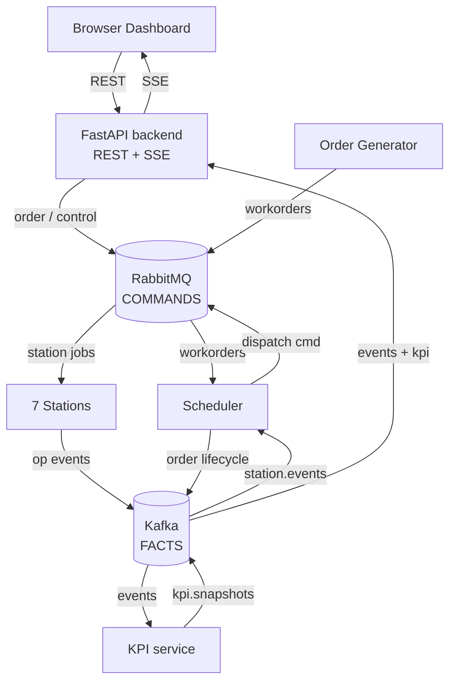
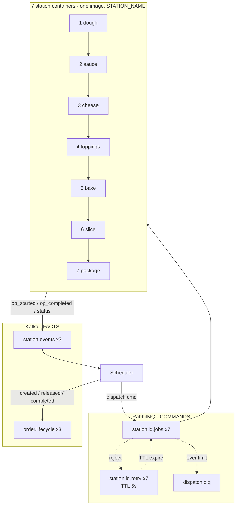
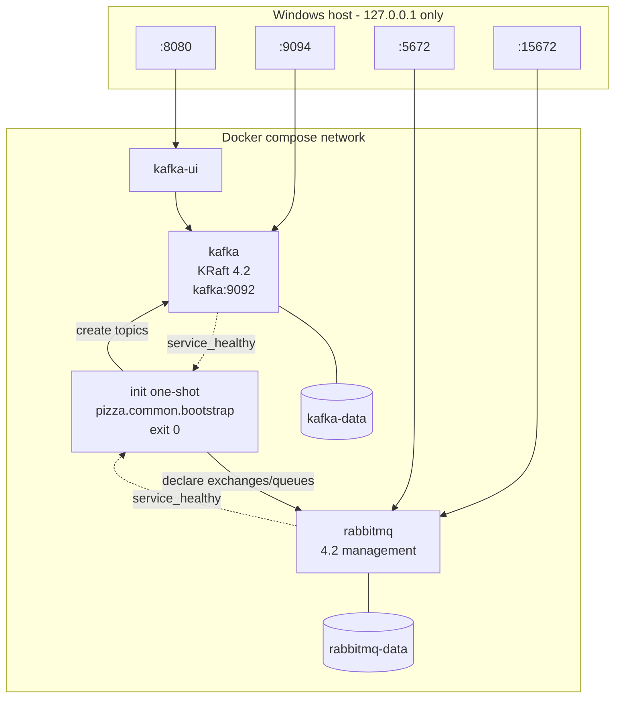
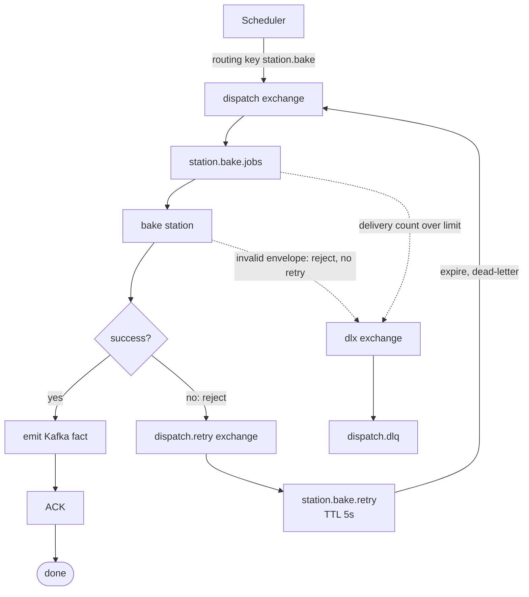
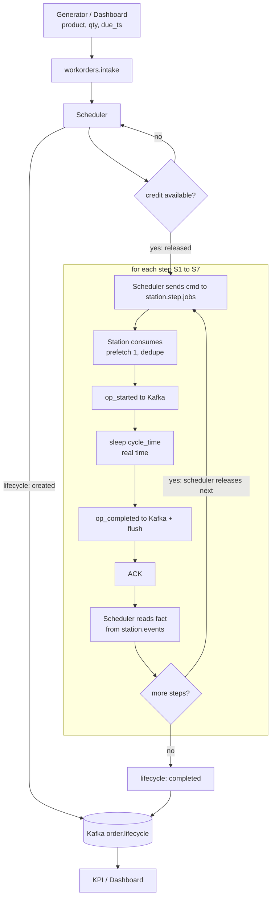
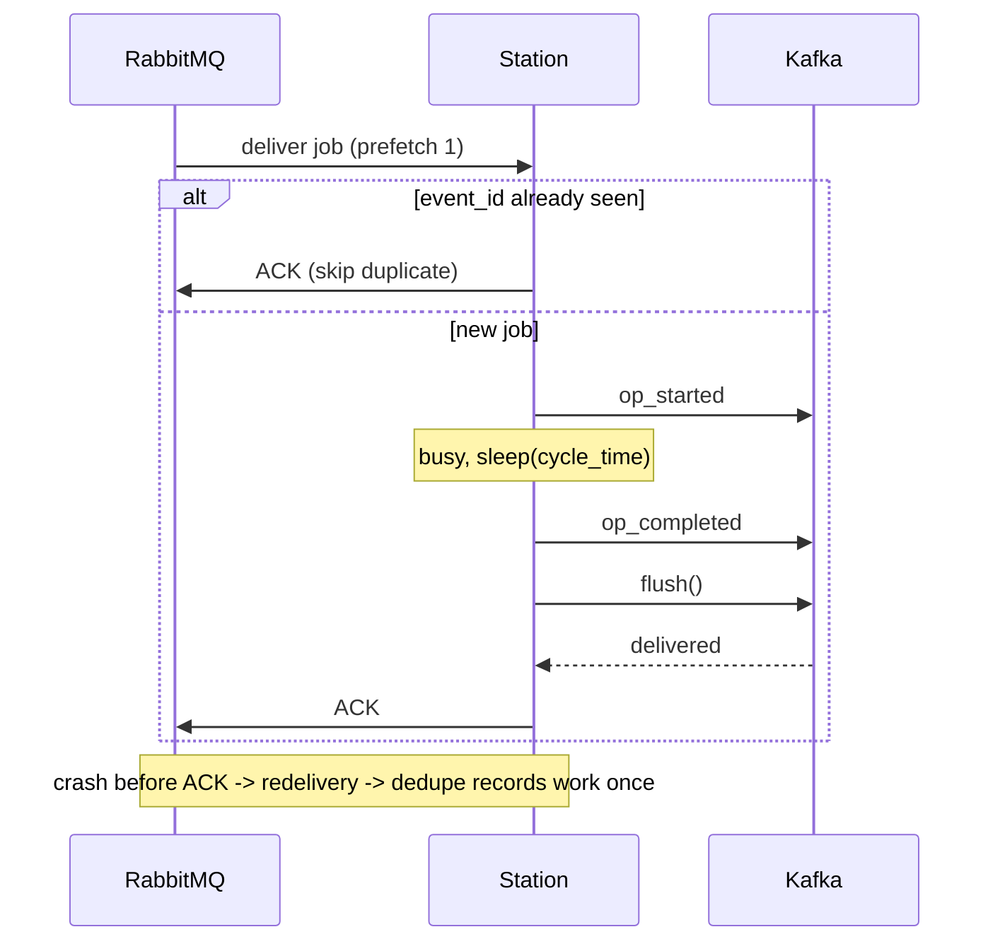
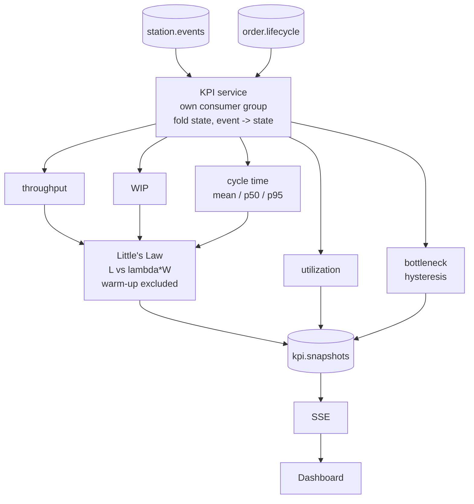
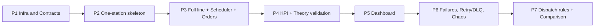

# 架構與流程圖

> 規則:RabbitMQ 傳指令(command),Kafka 傳事實(fact)。詳見 [messaging-roles.md](messaging-roles.md)。
> 標示 P2~P7 的元件為後續 Phase 的目標,Phase 1 已實作的是 Compose 堆疊與 topology。

## 1a. 系統架構圖(總覽)

## 1b. 產線細節(7 站與 broker 資源)

## 2. Docker Compose 部署圖(Phase 1 已實作)

## 3. RabbitMQ 重試 / DLQ 流程

## 4. 單張訂單流程

## 5. Station「先 Kafka 後 ack」時序(Phase 2)

## 6. KPI 資料流(Phase 4)

## 7. Phase 依賴

