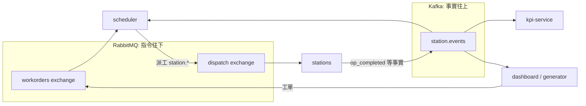

# 訊息角色規則:RabbitMQ 與 Kafka 各做什麼

## 1. 一句話規則

**RabbitMQ 傳指令、Kafka 傳事實。**

- 指令(command):「請你去做這件事」,有一個明確的接收者,做完要回報。
- 事實(fact):「這件事已經發生了」,不指定接收者,任何人想知道都可以讀,而且可以重播。

## 2. 白話名詞

- **envelope(信封)**:每一則訊息(不論指令或事實)最外層都有的共同欄位,像信封上的寄件資訊。內容(payload)因訊息類型而異,但信封欄位一律相同。
- **ack(確認)**:消費者處理完一則 RabbitMQ 訊息後告訴 broker「我做完了」,broker 才會把它從佇列刪掉。沒 ack 就斷線,訊息會重送。
- **DLQ(dead-letter queue,死信佇列)**:無法處理的訊息最後的歸宿。本專案的 DLQ 是 `dispatch.dlq`,方便人工檢視失敗原因。
- **consumer group(消費者群組)**:Kafka 中同一個 `group.id` 的消費者共同分擔 partition 並共享 offset;不同群組各自獨立讀完整個 topic。

## 3. 怎麼決定用哪一個

| 情境 | 使用 |
| --- | --- |
| 需要有人做事並回報 | RabbitMQ(指令) |
| 發生了某事,任何人想知道 | Kafka(事實) |

## 4. 指令範例(示例)

排程器透過 exchange `dispatch`,以 routing key `station.bake` 派一個 `bake` 工作。每站的 jobs 佇列為 `station.bake.jobs`。以下欄位僅為示例,各訊息類型的專屬欄位會在 Phase 2 之後定義。

```json
{
  "event_id": "11111111-1111-4111-8111-111111111111",
  "run_id": "run-demo-0001",
  "line_id": "pizza-1",
  "machine_id": "bake",
  "ts": "2026-01-01T00:00:00Z",
  "schema_version": 1,
  "exchange": "dispatch",
  "routing_key": "station.bake",
  "order_id": "order-0001",
  "step": "bake"
}
```

## 5. 事實範例(示例)

`bake` 站完成加工後,發出 `op_completed` 事件到 Kafka topic `station.events`,message key 為 `bake`。以下同樣是示例。

```json
{
  "event_id": "22222222-2222-4222-8222-222222222222",
  "run_id": "run-demo-0001",
  "line_id": "pizza-1",
  "machine_id": "bake",
  "ts": "2026-01-01T00:00:05Z",
  "schema_version": 1,
  "type": "op_completed",
  "order_id": "order-0001"
}
```

## 6. 指令 / 事實流程圖



scheduler 負責站與站之間的交接:某站完成(Kafka 事實)後,由 scheduler 決定並透過 RabbitMQ 派下一站的指令。

## 7. envelope 欄位

| 欄位 | 說明 |
| --- | --- |
| `event_id` | 訊息唯一 ID(UUID),消費者以此做冪等 |
| `run_id` | 一次模擬執行,由「開始」動作產生,同一次 run 的所有訊息共用 |
| `line_id` | 固定為 `pizza-1` |
| `machine_id` | 站名,例如 `bake`;未來平行機台用 `bake-1`、`bake-2` |
| `ts` | UTC ISO8601 字串,以 `Z` 結尾 |
| `schema_version` | 整數,目前為 `1`;只有破壞性變更才升版 |

無效訊息規則:

- Producer 缺少必要欄位時拒絕發送(拋出驗證例外,什麼都不送)。
- RabbitMQ 消費者收到無效訊息(`dead_letter_invalid`):發佈到 `dlx` 進入 `dispatch.dlq` 後 ack,從不 reject,不重試。
- Kafka 消費者收到無效訊息:記錄 log 並略過。

## 8. Topology 清單

Kafka topics(replication factor 1):

| Topic | Partitions | Key | 策略 |
| --- | --- | --- | --- |
| `station.events` | 3 | `machine_id` | delete,保留 30 天 |
| `order.lifecycle` | 3 | `order_id` | delete,保留 30 天 |
| `wip.snapshots` | 1 | station | compact |
| `kpi.snapshots` | 1 | n/a | compact |

RabbitMQ exchanges:`workorders`(direct)、`dispatch`(direct)、`dispatch.retry`(direct)、`scheduler.rework`(direct)、`dlx`(fanout)、`control`(topic)。

RabbitMQ queues(皆為 quorum queue):

- `workorders.intake`
- `station.<id>.jobs` x7
- `station.<id>.retry` x7(TTL 5 秒,到期後 dead-letter 回 `dispatch`;僅用於 jobs queue crash / delivery-limit 路徑)
- `scheduler.rework.<station>.hold` x7(TTL 5 秒,到期 dead-letter 到 `scheduler.rework`,key `return`;rework 冷卻用)
- `scheduler.rework.return`(由排程器消費)
- `dispatch.dlq`
- `scheduler.control`、`generator.control`、`station.<id>.control` x7
- `kpi.control`(由 kpi-service 消費,只承載 run.started)

兩條路徑目的不同:

- rework(06.2):站點回報 `op_failed` 並 ack,排程器歸還該站 credit,並把 lot 放入 `scheduler.rework.<station>.hold`(TTL 5s)-> `scheduler.rework` -> `scheduler.rework.return`,排程器消費後讓 `visit+1` 的 lot 回到待辦清單,於真實派工時才發佈指令到 `station.<id>.jobs`。
- jobs queue crash / delivery-limit(Phase 6 D-15):超過 delivery limit 的指令 -> `dispatch.retry` -> `station.<id>.retry`(TTL 5s)-> `dispatch` -> 回到 `station.<id>.jobs`。

## Phase 2 訊息型別

| type | 類別 | Broker / 路由 |
| --- | --- | --- |
| `job.command` | command | RabbitMQ `dispatch`,routing key `station.<s>` |
| `run.started` | command | RabbitMQ `control`,routing key `station.<s>.run` |
| `station.status` | fact | Kafka `station.events`,key = `machine_id` |
| `op.started` | fact | Kafka `station.events`,key = `machine_id` |
| `op.completed` | fact | Kafka `station.events`,key = `machine_id` |

`step` 即站點 slug(例如 `bake`),另有 `visit`(rework 時遞增)。`op.*` 事實帶有 `command_event_id`,是下游去重的身分依據(D-10:同一 `command_event_id` 或同一 `(order_id, step, visit)` 視為重複)。

## Phase 6 failure flow

Phase 6 的失敗處理遵守「RabbitMQ 傳指令、Kafka 傳事實」:

- 站點處理失敗時從不 reject。它先發 Kafka 事實 `op_failed`(`station.events`),再 ack 該指令。`op_failed` 有兩個來源:品質失敗(fail flag/poison)與機台故障(Phase 06.1:加工中 Down、修復後該 job 不續跑而判定失敗);事實帶選用欄位 `cause`(`breakdown` 或 `quality`,缺省視為 `quality`)。Down 時閒置與站點 offline/crash 不判定,offline 由 RabbitMQ 以相同 `visit` 重送。兩種來源共用同一張 rework 上限表。
- 排程器收到 `op_failed` 後,若該站 rework 次數未達上限,立即歸還該站 credit,並把 lot 放入 `scheduler.rework.<station>.hold` 等待 TTL;TTL 後由排程器自 `scheduler.rework.return` 取回,`visit+1` 的 lot 回到待辦清單,真實派工時才發佈 RabbitMQ 指令。站點不因失敗 lot 冷卻而被佔用。
- rework 用盡時,排程器把指令送到 `dlx`,進入 `dispatch.dlq`,並在 `order.lifecycle` 發出 `failed` 事實。jobs queue 未宣告 `x-delivery-limit`,實際上限為 RabbitMQ 4.x 預設的 20,僅作為 crash 迴圈的最後防線。
- 故障注入走指令通道:`machine.break` 與 `machine.repair` 送到 `station.<id>.control`;`lot.bank` 與 `lot.release` 送到 `scheduler.control`。

指令範例(RabbitMQ `control` exchange,`station.bake.control`):

```json
{"type": "machine.break", "machine_id": "bake", "duration_s": 30}
```

事實範例(Kafka `station.events`,key = `machine_id`):

```json
{"type": "op_failed", "machine_id": "bake", "order_id": "order-0001", "step": "bake", "visit": 1, "cause": "breakdown"}
```

## Phase 7 dispatch rules and comparison

Phase 7 新增兩對指令/事實,同樣遵守「RabbitMQ 傳指令、Kafka 傳事實」:

- **指令 `scheduler.set_rule`(routing key `scheduler.rule`)vs 事實 `rule.changed`**:儀表板經 RabbitMQ `control` exchange,以 routing key `scheduler.rule`(綁定 `scheduler.#` 到佇列 `scheduler.control`)送出 `SetRule` 指令切換派工規則(FIFO/EDD/SPT);排程器套用後,發佈事實 `rule.changed` 到 Kafka `station.events`,記錄實際生效的規則,任何消費者(儀表板、重播)都可讀到規則何時改變(D-04)。
- **指令 `kpi.close_round`(routing key `kpi.close`)vs 事實 `comparison.result`**:當一輪比較的訂單全部完成或被手動結束時,儀表板經 RabbitMQ `control` exchange,以 routing key `kpi.close`(綁定 `kpi.#` 到佇列 `kpi.control`)送出 `RoundClose` 指令通知 KPI 服務收尾該輪;KPI 服務發佈事實 `comparison.result` 到 Kafka `kpi.snapshots`,key 為 `cmp:<comparison_id>:<round>`,帶有這一輪(一個規則、一批工單)的 mean cycle time、tardiness、延遲比例與 makespan。
- **Recompute 只重播,從不發佈**:`POST /api/runs/{run_id}/recompute` 以一個全新的 `replay-<uuid>` consumer group、`auto.offset.reset=earliest` 重播 `station.events` 與 `order.lifecycle`,純函式重算 KPI 後與既有的 `kpi.snapshots` 快照比較,結果只回應給呼叫者(HTTP response),從不送出任何 Kafka 或 RabbitMQ 訊息,也不提交 offset(D-13)。
- **交期 KPI 只在 KPI fold 計算**:`due_ts` 相關的 tardiness、延遲比例等指標只由 KPI 服務的純函式 `fold` 計算(消費 `order.lifecycle` 的 `due_ts` 與完成時間),排程器與 dashboard 本身不重複計算交期邏輯。

指令範例(RabbitMQ `control` exchange,routing key `scheduler.rule`,佇列 `scheduler.control`):

```json
{"type": "scheduler.set_rule", "machine_id": "scheduler", "rule": "edd"}
```

事實範例(Kafka `station.events`,key = `machine_id`):

```json
{"type": "rule.changed", "machine_id": "scheduler", "rule": "edd"}
```

## Phase 8 recipe change facts

Phase 8 新增兩對指令/事實,同樣遵守「RabbitMQ 傳指令、Kafka 傳事實」:

- **指令 `recipe.set`(routing key `station.<name>.recipe`、`scheduler.recipe`、`kpi.recipe`)vs 事實 `recipe.changed`**:送出 `SetRecipe` 指令後,站點套用新的單位加工秒數;若該站正處於執行中的 run,站點發佈恰好一筆事實 `recipe.changed` 到 Kafka `station.events`(key 為站名),帶站點、品項、舊值、新值與套用時間(事實自身的 `ts`)。事實在站點寫入記憶體表之前發出,因此發佈失敗時表不會被改寫,重送只會產生一筆事實。
- **指令 `run.started` vs 事實 `recipe.snapshot`**:排程器處理 `run.started` 時,在 `core.start_run` 之前發佈恰好一筆事實 `recipe.snapshot` 到 Kafka `station.events`,key 為 `scheduler`(與 `rule.changed` 同一 stream),內含七站的生效 recipe 表。
- **規則**:兩種事實都是既有 union 的附加成員,位於既有的 `station.events` topic;不新增 topic,也不改 `schema_version`。
- **規則**:執行中的修改逐筆記錄為 `recipe.changed`;在 run 開始前的修改不發出 `recipe.changed`,而是由下一筆 `recipe.snapshot` 一併記錄。
- **限制**:即時修改只存在記憶體中,站點**重啟**後表會回到 TOML 的磁碟值。
- **限制**:站點容器停止時送出的指令會留在其控制佇列中,待站點啟動後才生效(並在當時發出事實),這段期間為**尚未生效**的窗口。
- **重播**:重算以該 run 最新的 `recipe.snapshot`,加上所有 `ts` 不晚於已儲存 KPI 快照 ts 的 `recipe.changed`,重建生效表,並在報告中標示來源;沒有 snapshot 的歷史 run 回退到磁碟表,報告標示來源為 `disk`。

指令範例(RabbitMQ `control` exchange,routing key `station.sauce.recipe`):

```json
{"type": "recipe.set", "event_id": "5b0f2c1e-8a4d-4c2b-9e61-3f7a2d9c4b10", "run_id": "run-20261020-01", "line_id": "line-1", "machine_id": "sauce", "ts": "2026-10-20T09:30:00.000Z", "schema_version": 1, "station": "sauce", "product": "margherita", "unit_time_s": 40.0}
```

事實範例(Kafka `station.events`,key = `sauce`):

```json
{"type": "recipe.changed", "event_id": "9d2e7a41-3c6b-4f08-8b15-7a0e4c2d9f63", "run_id": "run-20261020-01", "line_id": "line-1", "machine_id": "sauce", "ts": "2026-10-20T09:31:12.345Z", "schema_version": 1, "station": "sauce", "product": "margherita", "old_unit_time_s": 30.0, "new_unit_time_s": 40.0}
```

事實範例(Kafka `station.events`,key = `scheduler`):

```json
{"type": "recipe.snapshot", "event_id": "c4a1f8e2-6b3d-4e97-a0c5-2f8d1b7e3a94", "run_id": "run-20261020-01", "line_id": "line-1", "machine_id": "scheduler", "ts": "2026-10-20T09:30:00.120Z", "schema_version": 1, "recipes": {"spin": {"margherita": 20.0, "pepperoni": 20.0, "veggie": 20.0}, "sauce": {"margherita": 15.0, "pepperoni": 15.0, "veggie": 15.0}, "cheese": {"margherita": 18.0, "pepperoni": 18.0, "veggie": 18.0}, "toppings": {"margherita": 25.0, "pepperoni": 27.0, "veggie": 26.0}, "bake": {"margherita": 60.0, "pepperoni": 60.0, "veggie": 60.0}, "slice": {"margherita": 12.0, "pepperoni": 12.0, "veggie": 12.0}, "package": {"margherita": 10.0, "pepperoni": 10.0, "veggie": 10.0}}}
```

## Phase 07.2 priority change facts

Phase 07.2 以整數優先權(1~99,數字越小越緊急,預設 50)取代 rush/normal,並新增一對指令/事實,同樣遵守「RabbitMQ 傳指令、Kafka 傳事實」:

- **指令 `lot.set_priority`(routing key `scheduler.priority`,既有 `scheduler.#` 綁定)vs 事實 `priority.changed`**:儀表板 `POST /api/lot/{order_id}/priority` 轉送 `LotSetPriority`;排程器自行再驗證,發佈恰好一筆事實 `priority.changed` 到 Kafka `order.lifecycle`(key = `order_id`),帶 `order_id`、`previous_priority`、`new_priority`、`source`,套用時間為事實自身的 `ts`。事實在排程器改動記憶體狀態之前發出。
- **規則**:值未變(no-op)不發任何事實;未知、已終結的工單被排程器丟棄。REST 層對未知工單回 404、已終結或尚未釋放的工單回 409、值超出 1~99 回 422。
- **規則**:不搶占。只重排排程器待辦(優先權 → 規則鍵 → `entered_ts`),加工中的 lot 與 RabbitMQ 站佇列不變。
- **規則**:事實是既有 `order.lifecycle` union 的附加成員,不新增 topic,`schema_version` 維持 1。
- **重播**:排程器 `rebuild` 與儀表板 fold 重播 `priority.changed` 還原相同順序;舊事件的 `rush` 欄位重播時 `true` 視為 10、`false` 或缺漏視為 50。

指令範例(RabbitMQ `control` exchange,routing key `scheduler.priority`):

```json
{"type": "lot.set_priority", "machine_id": "scheduler", "order_id": "ord-0001", "priority": 5}
```

事實範例(Kafka `order.lifecycle`,key = `ord-0001`):

```json
{"type": "priority.changed", "machine_id": "scheduler", "order_id": "ord-0001", "previous_priority": 50, "new_priority": 5, "source": "manual"}
```

